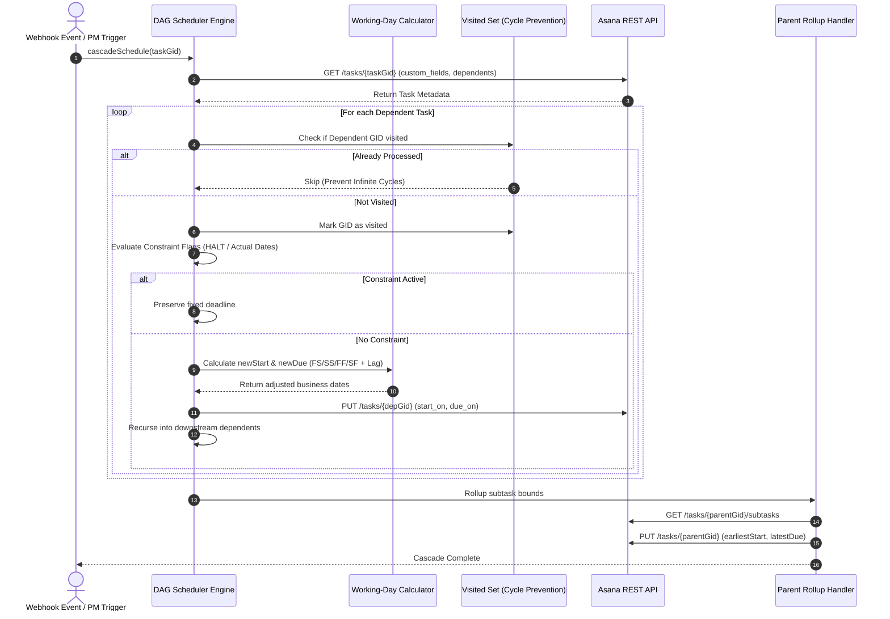

# 🚀 Asana Project Management Automation & DAG Cascade Engine

<div align="center">

### *"Automating Project Timelines, Dependency Cascades, and Workspace Migration at Scale."*

[](https://nodejs.org/)
[](https://www.python.org/)
[](https://developers.asana.com/)
[](https://en.wikipedia.org/wiki/Directed_acyclic_graph)
[](LICENSE)

[Overview](#-overview) • [Key Features](#-key-features) • [Architecture](#-system-architecture) • [Dependency Logic](#-dependency-relationship-modes) • [Getting Started](#-getting-started) • [Security](#-security--data-confidentiality)

</div>

---

> [!NOTE]
> **Data Privacy Notice**: All proprietary client data, corporate workspace JSON dumps, and active Asana Personal Access Tokens (PATs) have been thoroughly scrubbed from this repository. Dummy schemas and environment variable templates are provided for safe demonstration and execution.

---

## 📌 Overview

In complex multi-phase enterprise initiatives, managing task dependencies manually in Asana is error-prone and time-consuming. When an upstream blocker shifts by three days, project managers often have to manually adjust dozens of dependent tasks, verify lead/lag times, skip weekends, and update parent milestone dates.

**Asana Project Management Automation** provides an enterprise-grade automation engine and migration toolkit:
1. **Dynamic Timeline Scheduler**: A Node.js Directed Acyclic Graph (DAG) cascade engine that propagates schedule shifts through dependent tasks while respecting calendar working days and constraint locks.
2. **Workspace Migration & Disaster Recovery**: A Python multi-threaded toolkit that exports full project hierarchies, maps cross-workspace user GIDs, and recreates projects with automated rate-limit backoff.

---

## ✨ Key Features

- **⚡ Recursive Dependency Cascading**: Automatically recalculates and updates start and due dates for all downstream dependents upon task date modification.
- **📅 Smart Working-Day Calendar**: Skips Saturdays and Sundays automatically during timeline calculations, ensuring deadlines never fall on weekends.
- **⏱️ Lead & Lag Time Computation**: Supports positive lag (delays) and negative lag (buffer overlaps) between dependent tasks.
- **🔒 Constraint Lock Protection**: Honors milestone constraint flags (`Yes`, `Actual Start Date`, `Actual Due Date`, `HALT`), halting automatic cascades on fixed commitments.
- **📈 Parent Milestone Rollups**: Automatically inspects subtask date bounds, setting the parent task's start date to the earliest subtask and due date to the latest subtask.
- **📦 Multi-Threaded Workspace Exporter**: Leverages Python `ThreadPoolExecutor` to export entire Asana workspaces (projects, custom fields, enum options, tasks, and subtasks) with pagination.
- **🔄 Disaster Recovery & Workspace Cloner**: Recreates project boards, sections, and tasks in target workspaces with exponential backoff handling HTTP 429 rate limits.
- **👥 User GID Mapping Tool**: Extracts workspace users and builds translation maps for seamless cross-workspace team migrations.

---

## 🏛️ System Architecture



---

## 🔗 Dependency Relationship Modes

The scheduling engine supports all 4 standard project management dependency relationships:

| Relationship | Code | Logic | Example Use Case |
| :---: | :---: | :--- | :--- |
| **Finish-to-Start** | `FS` | Dependent starts the next business day after the parent task completes ($+ \text{Lag}$). | QA testing begins after backend API deployment completes. |
| **Start-to-Start** | `SS` | Dependent starts simultaneously with parent start date ($+ \text{Lag}$). | Documentation writing starts when feature development starts. |
| **Finish-to-Finish** | `FF` | Dependent must finish concurrently with parent due date ($- \text{Duration}$). | Translation work finishes when final editorial review finishes. |
| **Start-to-Finish** | `SF` | Dependent finishes when parent starts ($- \text{Duration}$). | Legacy server decommissioning finishes when new cluster goes live. |

---

## 📂 Project Structure

```text
asana-project-automation/
├── config.py                       # Centralized Python environment & path loader
├── package.json                    # Node.js dependencies & test scripts
├── requirements.txt                # Python dependencies (asana, python-dotenv)
├── .env.example                    # Template environment variables
├── .gitignore                      # Security rules blocking raw JSON & logs
├── LICENSE                         # MIT License
├── scheduler/
│   ├── dependency_scheduler.js     # Core DAG cascade engine & date arithmetic
│   └── test_scheduler.js           # Working day arithmetic simulation test suite
├── exporter/
│   ├── asana_workspace_exporter.py # Multi-threaded workspace backup engine
│   └── workspace_summary.py        # Workspace health & member audit reporter
├── migration/
│   ├── asana_project_restore.py    # Project recreation & recovery pipeline
│   ├── update_asana_tasks.py       # Batch task updater with rate-limit backoff
│   └── user_gid_mapper.py          # Cross-workspace user GID extraction tool
├── webhooks/
│   └── event_listener.py           # Real-time Asana event & webhook listener
└── data/
    └── sample/
        └── sample_task_tree.json   # Sanitized dummy task data schema
```

---

## 🚀 Getting Started

### 1. Prerequisites
- **Node.js** 18.x or newer
- **Python** 3.9+ and `pip`
- An **Asana Account** with developer access

### 2. Installation

1. **Clone the repository**:
   ```bash
   git clone https://github.com/Anvithgopa/asana-project-automation.git
   cd asana-project-automation
   ```

2. **Install Node.js dependencies**:
   ```bash
   npm install
   ```

3. **Install Python dependencies**:
   ```bash
   pip install -r requirements.txt
   ```

4. **Configure Environment Variables**:
   ```bash
   cp .env.example .env
   ```
   Edit `.env` with your Asana credentials:
   ```ini
   ASANA_ACCESS_TOKEN=your_personal_access_token_here
   ASANA_WORKSPACE_GID=your_workspace_gid_here
   DATA_DIR=./data
   LOG_DIR=./logs
   ```

---

## 🧪 Testing the Scheduler

Run the built-in calendar calculation test suite to verify working-day skips and lag computations:

```bash
npm test
```

Expected output:
```text
--- Testing Date & Working Days Engine ---
✅ PASSED: Friday + 1 working day is Monday (skips weekend)
✅ PASSED: Friday + 5 working days is next Friday
✅ PASSED: Monday - 1 working day is Friday (skips weekend)
✅ PASSED: Friday + 2 lag days is Tuesday
--- All Date Calculation Tests Passed Successfully! ---
```

---

## 🛠️ Usage Examples

### 1. Trigger Dependency Cascade on a Task
```bash
node scheduler/dependency_scheduler.js <TASK_GID>
```

### 2. Export Entire Workspace
```bash
python exporter/asana_workspace_exporter.py
```
Exports all projects, custom field settings, enum options, and task structures into `data/`.

### 3. Audit Workspace Health
```bash
python exporter/workspace_summary.py
```

### 4. Restore / Clone a Project from Backup
```bash
python migration/asana_project_restore.py ./data/backup.json "Q4 Infrastructure"
```

---

## 🔒 Security & Data Confidentiality

- **Zero Hardcoded Secrets**: All authentication tokens and workspace GIDs are strictly loaded via environment variables (`.env`).
- **Data Dump Exclusion**: The repository's [`.gitignore`](.gitignore) is pre-configured to ignore all `*.json` workspace dumps, `datas/`, `logs/`, and environment files.
- **Sanitized Dummy Schemas**: Only redacted schemas ([`sample_task_tree.json`](data/sample/sample_task_tree.json)) are version-controlled for architectural reference.

---

## 📄 License

Distributed under the **MIT License**. See [`LICENSE`](LICENSE) for details.

---

## 👤 Author & Maintainer

**Anvith Gopa**  
GitHub: [@Anvithgopa](https://github.com/Anvithgopa)
